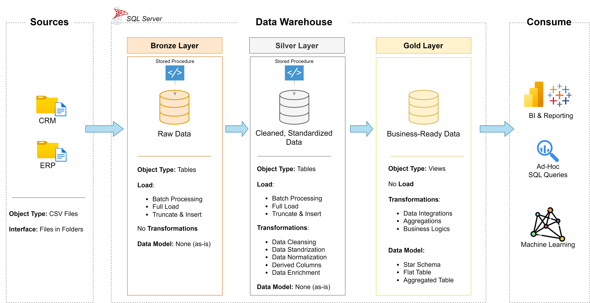

# SQL_Server_Data_Warehouse_Project
Buiulding a modern data warehouse with SQL Server, including ETL processes and data modeling.

**Welcome to my SQL Server Data Warehouse Project.**
This project demonstrates a comprehensive data warehousing and analytics solution, from building a data warehouse to generating actionable insights. Designed as a porfolio project. 

You can access to my Notion Notes here: " https://app.notion.com/p/Pedro-Coronel-DWH-Project-36243cac38278051a9e9d200d61b16bf?source=copy_link ".

---

## Data Architecture

The data architecture for this project follows Medallion Architecture **Bronze**, **Silver**, and **Gold** layers:


1. **Bronze Layer**: Stores raw data as-is from the source systems. Data is ingested from CSV Files into SQL Server Database.
2. **Silver Layer**: This layer includes data cleansing, standardization, and normalization processes to prepare data for analysis.
3. **Gold Layer**: Houses business-ready data modeled into a star schema required for reporting and analytics.

---

## Project Overview

This project involves:

1. **Data Architecture**: Designing a Modern Data Warehouse Using Medallion Architecture **Bronze**, **Silver**, and **Gold** layers.
2. **ETL Pipelines**: Extracting, transforming, and loading data from source systems into the warehouse.
3. **Data Modeling**: Developing fact and dimension tables optimized for analytical queries.

---

## PROJECT REQUIREMENTS


### Building the Data Warehouse

#### Objective
Develop a modern data warehouse using SQL Server to conslidate sales data, enablinng analytical reporting and informed decision-making.

#### Specifications
- **Data Sources**: Import data from two source systems (ERP & CRM) provided as CSV files. (Structured Type).
- **Data Quality**: Cleanse and resolve data quality issues prior to analysis.
- **Integration**: Combine both sources into a single, user-friendly data model designed for analytical queries.
- **Scope**: Focus on the atest dataset only; historization of data is not required.
- **Documentation**: Provide clear documentation of the data model to support both business stakeholders and analytics teams.


---

## 📂 Repository Structure
```
data-warehouse-project/
│
├── datasets/                           # Raw datasets used for the project (ERP and CRM data)
│   ├── source_crm/                     # CRM source: customers, products, sales details
│   ├── source_erp/                     # ERP source: customer birthdates and gender, locations, product categories
│   └── README.md                       # Datasets overview
│
├── docs/                               # Project documentation and architecture details
│   ├── data_architecture.png           # The project's architecture (bronze, silver, gold)
│   ├── data_flow.png                   # Data flow diagram
│   ├── data_integration.png            # How the source tables relate to each other
│   ├── data_model.png                  # Data model (star schema)
│   ├── ETL.png                         # The ETL techniques and methods used
│   ├── data_catalog.md                 # Catalog of the gold layer, field descriptions and metadata
│   └── naming_conventions.md           # Consistent naming guidelines for tables, columns, and files
│
├── scripts/                            # SQL scripts for ETL and transformations
│   ├── init_database.sql               # Creates the database and the three schemas
│   ├── bronze/                         # Scripts for extracting and loading raw data
│   ├── silver/                         # Scripts for cleaning and transforming data
│   └── gold/                           # Scripts for creating analytical models
│
├── tests/                              # Quality checks for the silver and gold layers
│
├── README.md                           # Project overview and instructions
└── .gitignore                          # Files and directories to be ignored by Git
```

---


---


## License
This project doesn't have any licence. However, public viewing of the source code and interaction with the project through the GitHub platform are permitted. Feel free to inspect whatever you want.
